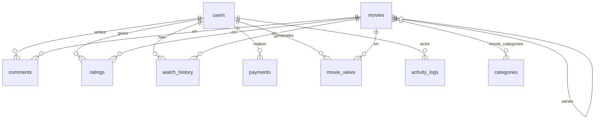

# DATABASE_DESIGN.md — MySQL cho PHIMHAY-GUI

## 1. Nguyên tắc chuyển đổi từ MongoDB

- ObjectId → `BIGINT UNSIGNED AUTO_INCREMENT` hoặc `CHAR(36)` UUID. **Đề xuất BIGINT** cho đơn giản.
- Quan hệ Category ↔ Movie: **bảng junction** `movie_categories` thay vì mảng lồng hai chiều.
- Episode stream: **không lưu** (giống gốc), lấy realtime từ phimapi; optional `episode_cache` (P2).

## 2. ERD (logical)



## 3. Bảng chi tiết

### 3.1 `users`

| Cột | Kiểu | Mô tả |
|-----|------|--------|
| id | BIGINT PK AI | |
| email | VARCHAR(255) UNIQUE NOT NULL | lowercase |
| password_hash | VARCHAR(255) NOT NULL | bcrypt |
| display_name | VARCHAR(100) UNIQUE NOT NULL | lowercase login alias |
| phone_number | VARCHAR(32) DEFAULT '' | |
| date_of_birth | DATE NULL | |
| gender | VARCHAR(32) DEFAULT '' | |
| role | ENUM('user','moderator','admin') DEFAULT 'user' | |
| is_vip | TINYINT(1) DEFAULT 0 | |
| vip_expires_at | DATETIME NULL | |
| is_unlimited_vip | TINYINT(1) DEFAULT 0 | |
| banned | TINYINT(1) DEFAULT 0 | |
| last_login | DATETIME NULL | |
| created_at, updated_at | DATETIME | |

**Index:** `(role)`, `(banned)`, `(is_vip, vip_expires_at)`.

### 3.2 `movies`

| Cột | Kiểu | Mô tả |
|-----|------|--------|
| id | BIGINT PK AI | |
| slug | VARCHAR(255) UNIQUE NOT NULL | |
| title | VARCHAR(512) NOT NULL | |
| origin_name | VARCHAR(512) DEFAULT '' | |
| poster_url | TEXT | |
| thumb_url | TEXT | |
| year | SMALLINT NULL | |
| type | VARCHAR(64) DEFAULT '' | series/single/... |
| content | MEDIUMTEXT | mô tả |
| country | VARCHAR(255) DEFAULT '' | |
| series_id | BIGINT NULL FK → movies.id | phim gốc series |
| part_number | INT NULL | |
| view_status | TINYINT DEFAULT 0 | 0 normal, 1 VIP only |
| comment_rating_policy | ENUM('public','members') DEFAULT 'public' | |
| is_active | TINYINT(1) DEFAULT 1 | |
| external_id | VARCHAR(64) DEFAULT '' | id phimapi |
| view_count | INT UNSIGNED DEFAULT 0 | |
| created_at, updated_at | DATETIME | |

**Index:** `(slug)`, `(is_active, updated_at)`, `(series_id)`, `(type)`, `(country)`.

### 3.3 `categories`

| Cột | Kiểu |
|-----|------|
| id | BIGINT PK AI |
| name | VARCHAR(100) UNIQUE NOT NULL |
| display_name | VARCHAR(150) DEFAULT '' |
| created_at, updated_at | DATETIME |

### 3.4 `movie_categories`

| Cột | Kiểu |
|-----|------|
| movie_id | BIGINT FK movies |
| category_id | BIGINT FK categories |
| PRIMARY KEY (movie_id, category_id) |

### 3.5 `comments`

| id | BIGINT PK |
| movie_id | FK |
| user_id | FK |
| body | VARCHAR(2000) |
| created_at | DATETIME |

**Index:** `(movie_id, created_at DESC)`.

### 3.6 `ratings`

| movie_id, user_id | PK composite |
| stars | TINYINT CHECK 1-5 |
| created_at, updated_at | DATETIME |

### 3.7 `watch_history`

| id | BIGINT PK |
| user_id | FK |
| movie_id | FK |
| episode | INT DEFAULT 1 |
| current_time_sec | INT DEFAULT 0 |
| created_at, updated_at | DATETIME |

**Unique:** `(user_id, movie_id, episode)` — upsert giống gốc.

**Index:** `(user_id, updated_at DESC)`.

### 3.8 `payments`

| id | BIGINT PK |
| user_id | FK |
| txn_ref | VARCHAR(64) UNIQUE |
| amount | INT NOT NULL |
| status | ENUM('pending','success','failed') |
| vnp_response | JSON NULL |
| created_at, updated_at | DATETIME |

### 3.9 `movie_views`

| id | BIGINT PK |
| user_id | FK NULL |
| movie_id | FK |
| ip_address | VARCHAR(45) |
| created_at | DATETIME |

**Index:** `(movie_id, created_at)`, `(created_at)`.

### 3.10 `activity_logs`

| id | BIGINT PK |
| actor_id | FK users NULL |
| actor_role | VARCHAR(32) |
| action | VARCHAR(64) |
| target_type | VARCHAR(32) |
| target_id | VARCHAR(64) |
| metadata | JSON |
| ip_address | VARCHAR(45) |
| created_at | DATETIME |

**Index:** `(action, created_at)`, `(created_at DESC)`.

### 3.11 `system_settings`

| id | BIGINT PK |
| setting_key | VARCHAR(32) UNIQUE DEFAULT 'global' |
| site_name | VARCHAR(128) |
| logo | TEXT |
| banner_images | JSON |
| maintenance_mode | TINYINT(1) |
| registration_enabled | TINYINT(1) |
| comments_enabled | TINYINT(1) |
| email_config | JSON |
| third_party_api_keys | JSON |
| updated_at | DATETIME |

### 3.12 `favorites` (Could-have — không có trong gốc)

| user_id, movie_id | PK |
| created_at | DATETIME |

## 4. Ràng buộc & toàn vẹn

- ON DELETE CASCADE: `comments`, `ratings`, `watch_history` theo user/movie where hợp lý.
- ON DELETE RESTRICT: không xóa movie còn history (hoặc soft delete `is_active=0` như gốc).
- Charset: `utf8mb4_unicode_ci`.

## 5. Quy trình MySQL Workbench

1. Cài MySQL Server 8.x trên Windows.
2. Workbench → **Create Schema** `phimhay_gui`.
3. **File → Run SQL Script** → chọn `database/init.sql`.
4. **Database → Reverse Engineer** để xem ERD trực quan.
5. Test user app: `CREATE USER 'phimhay'@'localhost' IDENTIFIED BY '...'; GRANT ALL ON phimhay_gui.*;`

## 6. Kiểm tra kết nối từ Flask

```python
# smoke test (phase 4)
from sqlalchemy import create_engine, text
engine = create_engine(os.environ["DATABASE_URL"])
with engine.connect() as c:
    assert c.execute(text("SELECT 1")).scalar() == 1
```

## 7. Dữ liệu mẫu

File: `D:\PHIMHAY-GUI\database\init.sql`

- 1 admin (password hash placeholder — đổi sau seed script).
- 3 categories mẫu.
- 0 phim (admin import qua GUI giống quy trình gốc).

## 8. Truy vấn đặc thù (mirror gốc)

**Continue watching:** subquery hoặc window function `ROW_NUMBER() PARTITION BY COALESCE(series_id, id) ORDER BY updated_at DESC`.

**Dashboard charts:** `GROUP BY DATE(created_at)` trên `activity_logs`, `movie_views`, `users`.

**Search:** `WHERE title LIKE %q% OR origin_name LIKE %q%` + FULLTEXT index (optional P2).
