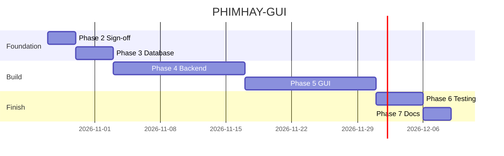

# DEVELOPMENT_ROADMAP.md

## Phase 1 — Project Analysis ✅

| Hạng mục | Nội dung |
|----------|----------|
| Công việc | Đọc PHIMHAY, liệt kê feature, models, API |
| Đầu ra | `PROJECT_ANALYSIS.md`, bảng xác minh tính năng |
| Tiêu chí | Mọi feature map có dẫn chứng file/route |
| Phụ thuộc | Truy cập `D:\PHIMHAY` |

**Trạng thái:** Hoàn thành trong lượt planning này.

---

## Phase 2 — Requirements and Architecture

| Công việc | Requirements, ARCHITECTURE, API_SPEC, GUI_DESIGN |
| Đầu ra | 4 file docs + quyết định CustomTkinter + Flask local |
| Tiêu chí | Stakeholder (bạn) review & sign-off |
| Phụ thuộc | Phase 1 |

---

## Phase 3 — Database

| Công việc | Chạy `init.sql` trên Workbench, seed admin script |
| Đầu ra | Schema `phimhay_gui`, user DB, doc ERD screenshot |
| Tiêu chí | Flask connect + `SELECT 1` |
| Phụ thuộc | MySQL cài trên Windows |

**Ước lượng:** 1–2 ngày

---

## Phase 4 — Backend

| Công việc | Flask app factory, SQLAlchemy models, repositories, JWT, port routes |
| Đầu ra | API tương thích spec, pytest cơ bản |
| Tiêu chí | Postman/collection pass các flow P0 |
| Phụ thuộc | Phase 3 |

**Thứ tự code:**

1. Config + DB + User + Auth  
2. Movies list/detail + phimapi service  
3. Categories, comments, ratings  
4. History + movie views  
5. Admin + settings + logs + dashboard  
6. Payment (optional)

**Ước lượng:** 1–2 tuần

---

## Phase 5 — GUI

| Công việc | Shell, api_client, từng view, tích hợp player |
| Đầu ra | App desktop chạy end-to-end |
| Tiêu chí | User story P0 qua GUI không cần Postman |
| Phụ thuộc | Phase 4 API ổn định |

**Thứ tự:**

1. Login/Register + token store  
2. Home + filters + detail  
3. Watch + history  
4. Profile  
5. Admin screens  

**Ước lượng:** 1–2 tuần

---

## Phase 6 — Testing

| Loại | Công cụ |
|------|---------|
| Unit | pytest — services (VIP logic, playback access) |
| API | pytest + Flask test client |
| DB | fixture MySQL test schema hoặc SQLite dev-only *không thay production* |
| GUI | manual test checklist + optional pytest-qt later |
| E2E | Script: register → import movie (admin) → watch → history |

**Tiêu chí:** Checklist 100% Must-have pass.

**Ước lượng:** 3–5 ngày

---

## Phase 7 — Documentation and Deployment

| Công việc | README, `.env.example`, hướng dẫn Workbench, `start.bat` |
| Optional | PyInstaller one-folder build |
| Tiêu chí | Máy Windows sạch cài được theo README |

**Ước lượng:** 2–3 ngày

---

## Milestone timeline (gợi ý 4–6 tuần part-time)

---

## Testing Strategy (tóm tắt)

| ID | Case |
|----|------|
| T-01 | Register duplicate email → 409 |
| T-02 | Login banned → 403 |
| T-03 | Guest GET movie detail → canWatch false, no episodes |
| T-04 | VIP movie + non-VIP user → blocked |
| T-05 | Import duplicate slug → 409 |
| T-06 | Category assign sync junction table |
| T-07 | History upsert same episode updates time |
| T-08 | Continue watching groups by series_id |
| T-09 | Maintenance blocks non-admin |
| T-10 | Flask stopped → GUI shows connection error |
| T-11 | Invalid JWT → 401 clears session |
| T-12 | phimapi timeout → 502 message |

Chi tiết mở rộng trong Phase 6 test plan file (optional `tests/TEST_PLAN.md`).
