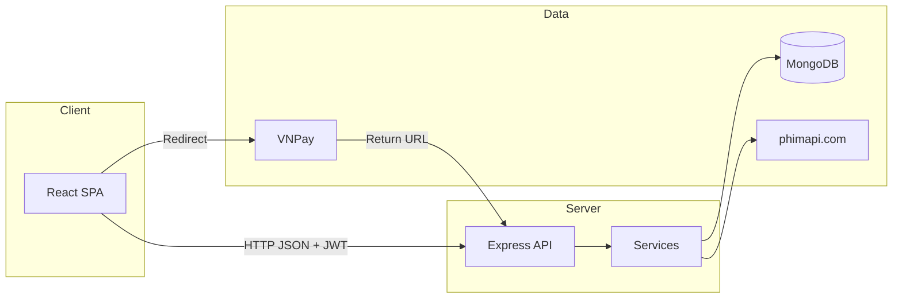

# PROJECT_ANALYSIS.md — Phân tích dự án PHIMHAY hiện tại

> Nguồn phân tích: `D:\PHIMHAY` (đọc source, **không** đọc nội dung secret trong `server/.env`).

## 1. Tổng quan

PHIMHAY là ứng dụng **xem phim trực tuyến** theo mô hình **monorepo**:

| Thành phần | Công nghệ |
|------------|-----------|
| Frontend | React 19 + TypeScript + Vite + React Router |
| Backend | Node.js + Express 4 |
| Database | **MongoDB** (Mongoose) |
| Auth | JWT (Bearer), bcrypt |
| API ngoài | **phimapi.com** (metadata + link phát) |
| Thanh toán | **VNPay** (sandbox) |
| Triển khai | Render (single service), có `vercel.json` cho serverless |

Express phục vụ REST API dưới `/api/*` và (khi có build) static SPA từ `client/dist`.

## 2. Cấu trúc thư mục

```
PHIMHAY/
├── package.json          # Script dev/build/start gốc
├── render.yaml           # Cấu hình deploy Render
├── RENDER_DEPLOY.md
├── vercel.json
├── client/               # SPA React
│   ├── src/
│   │   ├── api/client.ts
│   │   ├── context/AuthContext.tsx
│   │   ├── components/   # Layout, filter, continue watching...
│   │   ├── pages/        # Home, Login, MovieDetail, WatchPage, Admin...
│   │   └── admin/        # Dashboard, Users, Logs, Settings + trang content cũ
│   └── dist/             # Build production
└── server/
    ├── .env.example
    └── src/
        ├── app.js        # Express app, middleware, mount routes
        ├── index.js      # listen (local)
        ├── config.js     # env: Mongo, JWT, phimapi, VNPay
        ├── db.js         # Mongo connect (cache serverless)
        ├── models/       # Mongoose schemas
        ├── routes/       # API routers
        ├── controllers/
        ├── services/     # phimapi, dashboard, settings, activity log...
        ├── middleware/   # auth, rbac, rate limit, maintenance, validate
        ├── validators/   # Joi schemas
        └── utils/        # vnpay, requestMeta
```

## 3. Luồng nghiệp vụ cốt lõi

### 3.1 Catalog phim (local MongoDB)

- Admin **import** phim bằng `slug` từ phimapi → lưu metadata vào collection `Movie`.
- User xem danh sách từ DB (`isActive: true`), lọc theo `type`, `country`, `category`.
- **Tập phim / link phát không lưu trong MongoDB** — khi xem chi tiết, backend gọi `GET phimapi.com/phim/{slug}` và trả `episodes` (server_name, link_embed, link_m3u8).

### 3.2 Phân quyền xem phim

- `viewStatus`: `0` = user đăng nhập thường + VIP; `1` = chỉ VIP (hoặc admin).
- Guest: `canWatch: false` trên API detail; frontend yêu cầu đăng nhập.

### 3.3 Auth

- Đăng ký / đăng nhập (email hoặc displayName + password).
- JWT 7 ngày, middleware `optionalAuth` / `requireAuth`.
- Role: `user`, `moderator`, `admin` (enum trong User); route admin chủ yếu dùng `requireAdmin`.
- Bootstrap admin: header `x-admin-secret` khớp `INITIAL_ADMIN_SECRET` khi đăng ký.
- Khóa tài khoản: `banned`.

### 3.4 VIP & thanh toán

- User gọi `POST /api/payment/vnpay-create` → redirect URL VNPay.
- Callback `GET /api/payment/vnpay-return` → cập nhật Payment, gán VIP (`VIP_DURATION_DAYS`).
- Admin có thể gán VIP thủ công qua API users.

### 3.5 Tương tác xã hội

- Bình luận và đánh giá (1–5 sao) theo `movieId`.
- Chính sách `commentRatingPolicy`: `public` | `members`.
- Global toggle `commentsEnabled` trong SystemSettings.

### 3.6 Lịch sử xem

- Lưu `userId`, `movieId`, `episode`, `currentTime` (giây).
- Continue watching: gom theo `seriesId` hoặc từng phim, lấy bản ghi mới nhất.

### 3.7 Admin

- Dashboard thống kê + biểu đồ (Recharts trên client).
- Quản lý user (ban, role, reset password, VIP).
- Import/sửa/xóa phim, gán series, gán category.
- Activity logs, system settings (maintenance, registration, banners...).

## 4. Mô hình dữ liệu (MongoDB)

| Collection | Mục đích chính |
|------------|----------------|
| User | email, passwordHash, displayName, role, VIP, banned |
| Movie | slug, title, poster, categoryIds[], seriesId, viewStatus, viewCount |
| Category | name, displayName, movieIds[] (đồng bộ hai chiều với Movie.categoryIds) |
| Comment | movieId, userId, body |
| Rating | movieId, userId, stars (unique cặp) |
| WatchHistory | userId, movieId, episode, currentTime |
| Payment | txnRef, amount, status, vnpResponse |
| MovieView | log lượt xem + tăng viewCount |
| ActivityLog | audit hành động |
| SystemSettings | siteName, maintenance, registration, comments, emailConfig, API keys |

**Không có** collection/model cho **yêu thích (favorites)** — đã grep toàn repo (trừ node_modules).

## 5. API surface (tóm tắt)

- `GET /api/health`
- `/api/auth` — register, login, me, update profile
- `/api/movies` — list, search, filters, detail by slug, series, categories assign
- `/api/categories` — CRUD (admin cho write)
- `/api/comments`, `/api/ratings`
- `/api/history` — CRUD lịch sử
- `/api/payment` — VNPay
- `/api/settings/public`
- `/api/admin/*` — users, dashboard, logs, settings, movies import
- Swagger UI (một phần API category/series)

## 6. Frontend — màn hình đã triển khai

| Route | Chức năng |
|-------|-----------|
| `/` | Trang chủ, hero, lọc, phân trang, ContinueWatching |
| `/login`, `/register` | Auth |
| `/phim/:slug` | Chi tiết, trailer, series parts, comments/ratings |
| `/xem-phim/:slug` | Player iframe embed, chọn server/tập, lưu history |
| `/vip`, `/payment/return` | Mua VIP VNPay |
| `/profile` | Hồ sơ |
| `/watch-history` | Lịch sử xem |
| `/admin/*` | Dashboard, users, logs, settings, content (import phim, category) |

## 7. Thư viện & biến môi trường

**Server** (`server/.env.example`): `MONGODB_URI`, `JWT_SECRET`, `PORT`, `PHIMAPI_BASE`, `CLIENT_URL`, `INITIAL_ADMIN_SECRET`, `VNP_*`, `VIP_DURATION_DAYS`.

**Client**: `VITE_API_URL` (tùy chọn).

**Dependencies đáng chú ý**: express-rate-limit, joi, swagger-ui-express, axios, bcryptjs, jsonwebtoken, mongoose.

## 8. Điểm mạnh / hạn chế (cho bản desktop)

| Điểm mạnh | Hạn chế khi port sang desktop |
|-----------|-------------------------------|
| Tách API rõ, dễ tái sử dụng contract | Phụ thuộc phimapi + embed web cho video |
| RBAC, audit log, settings linh hoạt | VNPay redirect web — khó tích hợp native |
| Import phim tập trung | MongoDB-specific (transaction, aggregate) |

## 9. Phạm vi đã xác minh / chưa có

| Tính năng | Trạng thái |
|-----------|------------|
| Đăng nhập / đăng ký / JWT | Có |
| Phân quyền admin | Có |
| Role moderator trong schema | Có enum, **ít route dùng moderator** |
| Tìm kiếm / lọc phim | Có |
| Chi tiết + tập từ phimapi | Có |
| Bình luận / đánh giá | Có |
| Lịch sử xem / continue | Có |
| VIP + VNPay | Có |
| Yêu thích | **Không có** |
| Lưu tập phim trong DB | **Không** (proxy phimapi) |
| Email gửi thật | Cấu hình trong settings, **chưa thấy service gửi mail** |

## 10. Sơ đồ luồng (high level)



---

*Tài liệu phục vụ giai đoạn lập kế hoạch PHIMHAY-GUI (Flask + MySQL + Desktop GUI).*
